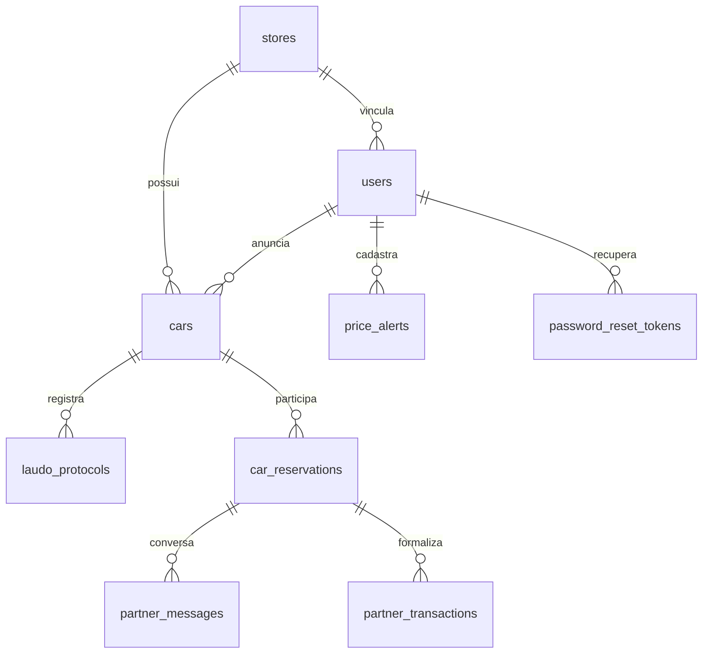

# Banco de dados do Automatch

Atualizado em **17/11/2026**, código `1b7d094`. Referência estrutural:
[models.py](backend/models.py) e [migrações Alembic](backend/alembic/versions).
Esta revisão leu o código; não consultou nem alterou um banco real.

A etapa demonstrativa de 17/11/2026 preservou esta estrutura. Os campos de
origem/consulta acrescentados à resposta HTTP de placa não criam colunas no
banco. A reformulação para a futura execução local aguarda autorização; não
foram alterados ORM, migrações ou dados reais.

## Persistência e ambientes

SQLAlchemy configura PostgreSQL pelo `DATABASE_URL`; SQLite exige modo de
desenvolvimento/teste apropriado. Produção rejeita SQLite. No Compose de
desenvolvimento, PostgreSQL 15 fica em `127.0.0.1:5433`; dentro da rede,
`db:5432`. Produção usa volume próprio e não expõe a porta do banco no host.

Há **14 entidades ORM**, além da tabela de controle `alembic_version` em bancos
migrados. Não confundir contagem de classes com tabelas de um banco específico;
uma instalação antiga pode estar em revisão diferente.

## Entidades e finalidade

| Modelo / tabela | Dados principais | Relações e observações |
| --- | --- | --- |
| `Store` / `stores` | Nome, slug, logo e descrição | Loja de veículos e usuários |
| `User` / `users` | Identidade, e-mail, hash, papel, subperfil, loja e `token_version` | E-mail único; versão invalida tokens antigos |
| `Car` / `cars` | Marca/modelo/ano/km/preço, mídia, descrição, placa, FIPE, laudo e condições B2B | Vínculos `store_id` e `user_id`; não presume certificação dos dados |
| `LaudoWatchlist` / `laudo_watchlist` | Veículo, placa, última conferência e situação | A tabela não comprova um monitor externo funcionando |
| `LaudoProtocol` / `laudo_protocols` | Protocolo, veículo, criação e snapshot textual | Protocolo único para PDF/validação pública |
| `PasswordResetToken` / `password_reset_tokens` | Conta, hash, validade, uso e criação | Coluna legada `otp_code` permanece vazia; código não é guardado aberto |
| `PaymentOrder` / `payment_orders` | Protocolo, cliente, item, valor, método e situação | Pedidos demonstrativos; produção sem provedor não confirma cobrança |
| `StorePartnership` / `store_partnerships` | Lojas solicitante/destinatária, situação, comissão e datas | Associação B2B entre lojas |
| `CarReservation` / `car_reservations` | Veículo, parceria, lojas, vendedor, preço, markup, prazo e situação | Reserva temporária; `closing_requested` registra pedido de fechamento |
| `PartnerTransaction` / `partner_transactions` | Protocolo, reserva, veículo, lojas, valor final, repasse e comissão | Registro de repasse; não é comprovação de pagamento bancário |
| `PartnerMessage` / `partner_messages` | Reserva, remetente, loja, texto e criação | Conversa B2B persistida, consultada por polling |
| `PartnerReview` / `partner_reviews` | Transação, lojas, notas e comentário | Avaliação entre parceiros |
| `PartnershipAuditLog` / `partnership_audit_logs` | Usuário, loja, ação, detalhes e data | Log persistido, sem garantia de imutabilidade |
| `PriceAlert` / `price_alerts` | Conta, veículo opcional, preço atual/alvo, canal, contato e situação | Cadastro persistente; não implementa envio automático |

Campos monetários relevantes usam `Numeric`, incluindo valores de anúncio,
repasse/comissões e alertas. Várias datas são strings ou timestamps numéricos;
não descrevê-las como `DateTime` uniformemente. `PriceAlert.car_id` é texto
opcional sem FK no ORM; não supor vínculo obrigatório onde não foi definido.

Favoritos, caches, preferências e parte do modo demonstrativo ficam no navegador,
sem tabela correspondente. Consultas DETRAN e canais multicanal usam dados de
exemplo, não entidades de um serviço oficial contratado.

## Relações principais



O diagrama destaca relações, sem reproduzir cada coluna ou toda a cardinalidade
opcional. Consultar as FKs/migrações antes de implementar exclusões.

## Migrações e atualização segura

O ponto de entrada recomendado é `backend/migrate.py`, que aplica
`alembic upgrade head` sem apagar tabelas ou executar seed. A cadeia inclui
baseline, consistência de tipos, índices/FKs, papéis, valores B2B,
`006_session_revocation` e `007_persist_price_alerts`.

Com ambiente/banco de destino corretamente configurados e backup conferido,
no diretório `backend`:

```sh
alembic current
alembic heads
python migrate.py
alembic current
```

Não executar esses comandos contra uma base desconhecida. Bancos legados sem
histórico precisam de análise da baseline; não usar reset, recriação de tabelas
ou `stamp head` automático como solução. Criar tabelas no startup não substitui
a trilha de migrações. O seed de desenvolvimento preenche exemplos ausentes,
preservando alterações existentes; produção usa configuração administrativa própria.

## Verificações e operação

`python run_tests.py` cria bases SQLite e diretórios temporários; não usa a base
local. O CI também aplica/reaplica migrações em PostgreSQL e SQLite. Isso não
substitui homologação de uma migração sobre cópia representativa da instalação.

Definir backup, retenção, restauração, acesso, segredos, proteção das mídias e
regras de exportação/anonimização. Não há cifragem integral do banco ou rotina
automática de backup comprovada apenas pelo ORM. Ver [segurança](SECURITY.md),
[arquitetura](docs/arquitetura.md) e [execução](docs/configuracao-e-execucao.md).
