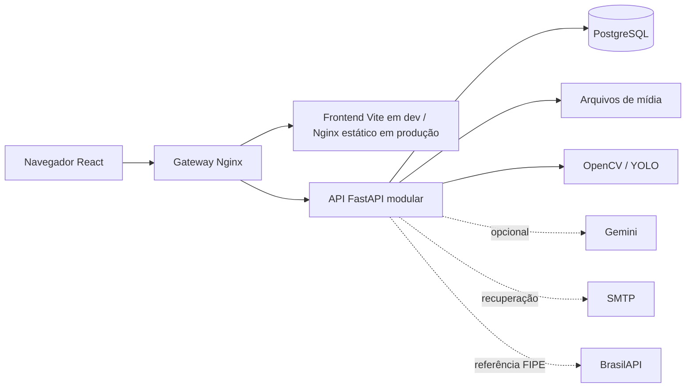

# Arquitetura do Automatch

Atualizada em **17/11/2026**, melhorias demonstrativas sobre a base `444bc09`.
Fontes: `frontend/package.json`, `backend/requirements.txt`, `backend/main.py`,
Compose, gateways e workflows versionados.

## Componentes e fluxo

O backend é uma aplicação modular com roteadores, não um conjunto de
microsserviços de negócio independentes. O Compose define quatro serviços:
`db`, `backend`, `frontend` e `gateway`. Redis não faz parte da configuração.

| Camada | Implementação |
| --- | --- |
| SPA | React 18, Router 7, Vite 8, TailwindCSS 3; rotas e modais sob demanda |
| Estado | Contextos de autenticação/tour, gerenciadores de catálogo/favoritos e armazenamento local |
| HTTP | `apiClient.js`, timeout padrão de 10 s, cancelamento e retry limitado a GET; chamadas podem ter configuração própria |
| API | FastAPI/Pydantic, roteadores de autenticação, veículos, visão, laudos, uploads, alertas e B2B |
| Dados | SQLAlchemy, PostgreSQL 15 e SQLite para testes/dev; migrações Alembic |
| IA/documentos | OpenCV/Ultralytics, Gemini opcional, heurísticas, Pillow, ReportLab e QR Code |
| Background | APScheduler e rate limiting em processo; produção configurada com um worker |

A existência de biblioteca/endpoint não comprova uso em uma tela. Scanner de
pneus e diagnóstico acústico foram retirados na limpeza de 18/11/2026,
incluindo os componentes, endpoints e funções de serviço sem uso. O 360° é sequência de fotos, não reconstrução geométrica 3D.

## Fronteiras de dados e acesso

- Catálogo com API usa registros do banco. Modo demo pode apresentar dados locais;
  cache não comprova propriedade de anúncio nem confirmação de uma transação.
- Conta tem papel `comum`, `lojista` ou `admin`, vínculo opcional à loja e
  `sub_role`. Autorização deve ser conferida em cada operação no servidor.
- JWT inclui versão da conta, conferida na autenticação; troca de senha e
  anonimização invalidam versões anteriores. Favoritos continuam locais.
- Operações B2B dependem da API. Reserva usa aquisição condicional; fechamento
  e cancelamento confirmam o resultado antes do sucesso na interface.
- Mensagens B2B são consultadas por polling, com isolamento de sessão/conversa
  e descarte de respostas antigas. Não há WebSocket nesse fluxo.
- Emissão de PDF usa snapshot/protocolo registrados. Validação pública comprova
  o registro Automatch consultado, não a veracidade material de uma perícia.
- Migrações incrementais e seed têm finalidades distintas. Não apagar banco ou
  aplicar `stamp` automaticamente para contornar divergências.

## Integrações e alternativas

Gemini é opcional; os modelos/SDKs presentes precisam ser homologados quando
ativados. Falta de chave pode acionar análise/resposta local, sem comprovar a
precisão de uma análise remota. DETRAN e preenchimento por placa são simulados.
FIPE pode vir de BrasilAPI, cache por código/ano ou cadastro; não há preço fixo substituto na rota de consulta.

Multicanal identifica a simulação sem URLs de publicação. XML da API lê o catálogo existente e filtra por loja; a demonstração local exporta o anúncio escolhido.
Alertas são registrados na API ou localmente em demo, com estado separado por conta. Há prévia no site; monitoramento e envio externo não estão implementados.
Checkout de produção fica indisponível sem provedor de pagamento. SMTP atende
recuperação de acesso quando configurado; não existe envio operacional por
simplesmente cadastrar um alerta de preço.

## Ambientes e exposição

| Serviço | Desenvolvimento | Produção Compose |
| --- | --- | --- |
| Gateway | Host 80 e 3000 | Host 80 e 443 publicados |
| Frontend | `127.0.0.1:5173` | Sem porta direta no host |
| Backend | `127.0.0.1:8000` | Sem porta direta no host |
| Banco | `127.0.0.1:5433` | Sem porta direta no host; volume persistente |

O `nginx.prod.conf` atual escuta HTTP em 80. Expor 443 no Compose não configura
TLS, certificados, HSTS ou CSP automaticamente. Não descrever essa configuração
como HTTPS pronto ou hardening certificado. Definir terminação TLS e testar os
cabeçalhos na implantação.

GitHub Pages publica somente o frontend do principal em demonstração. O build
usa a base do repositório; a mesma base de código pode ser sincronizada sem
publicar um segundo Pages institucional. Workflows têm permissões próprias.

## Riscos e trabalho pendente

Operação real exige segredos exclusivos, PostgreSQL, armazenamento/backup,
restauração, monitoramento, privacidade, limites de uso e homologação externa.
Escala horizontal requer compartilhar scheduler/limitadores e revisar concorrência.
Não há certificação WCAG AAA, integridade absoluta ou meta universal de latência.

Os [ADRs](decisoes/README.md) preservam decisões históricas com complementos.
Ver [estado atual](estado-atual.md), [banco](DOCUMENTACAO_BANCO_DE_DADOS.md),
[execução](configuracao-e-execucao.md) e [segurança](../SECURITY.md).

O repositório principal conta com deploy automatizado da demonstração no GitHub Pages a cada commit integrado na branch `main` (com disparo manual como contingência). Não há reformulação de entidades/migrações de banco antes de nova autorização.

## Complemento de 19/11/2026

A auditoria autorizada aplicou as migrações 006–008 e reparos pontuais após backup/ensaio, sem reformulação de entidades. Contratos de inspeção v2 substituem scores/pontos fabricados; COCO não é detector de avarias. Cronograma canônico em `shared/pericial-timeline.json`, com consumidores gerados por contexto Docker existente. As ferramentas de treino/HTTP em `backend/tools` não são importadas na API publicada. [Relatório atual](auditoria-scanner-video-2026-11-19.md).
